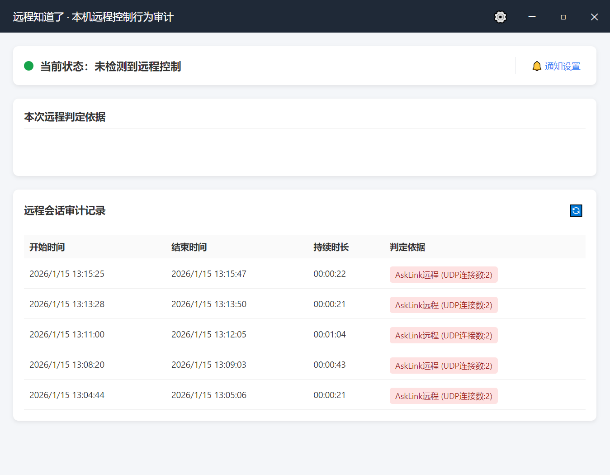
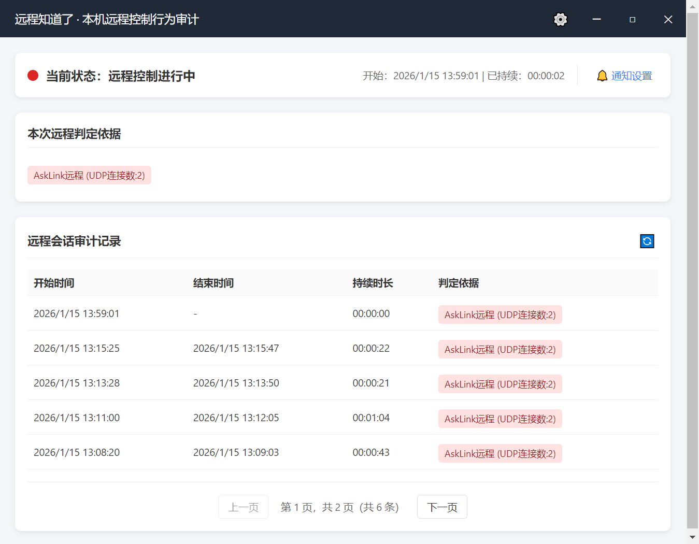
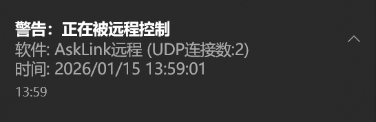
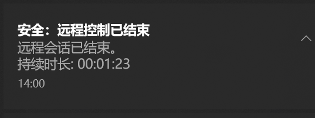
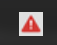
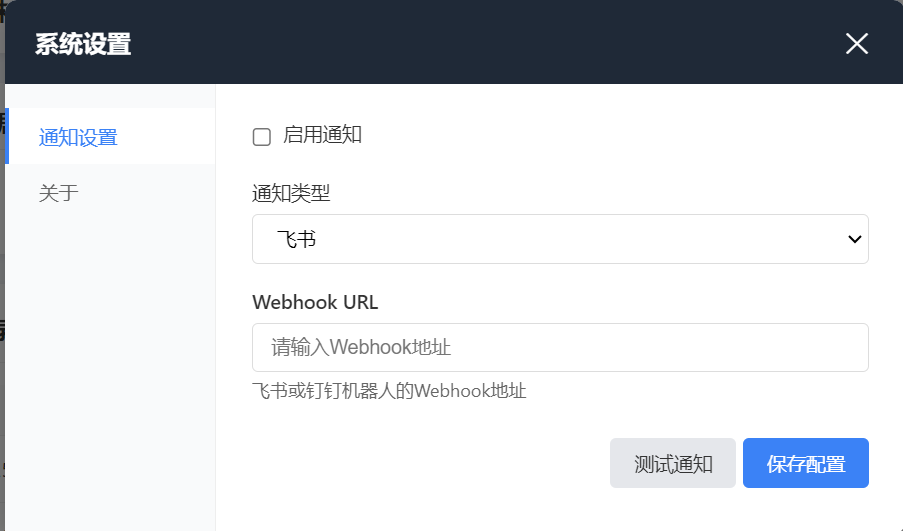
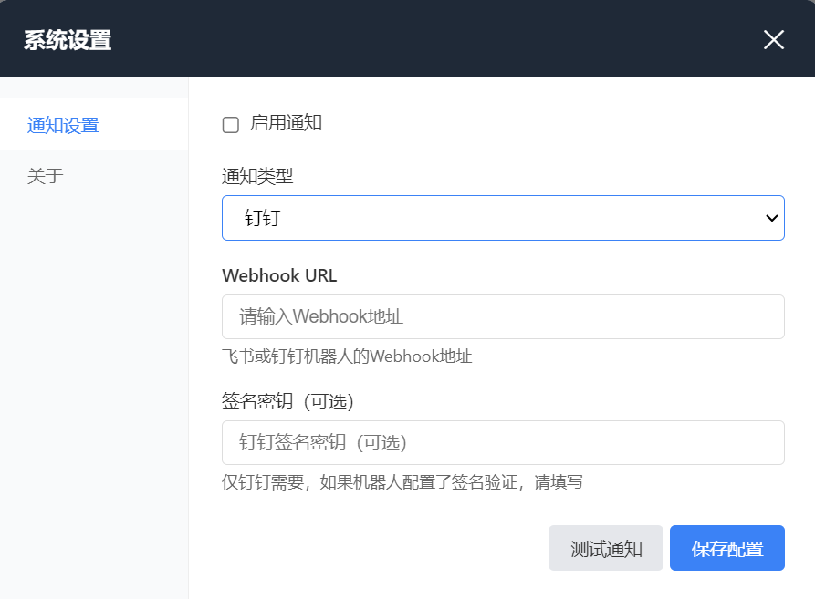

<div align="center">
  
  <h1>RemoteKnown (远程知道了)</h1>
  <p>
    <b>本地终端远程行为感知与审计系统</b>
  </p>
  <p>
    让用户"清楚知道自己是否、何时、正在被远程控制"，保护隐私安全。
  </p>

  <p>
    <a href="README.md">简体中文</a> | <a href="README_en.md">English</a>
  </p>

  <p>
    <a href="https://github.com/samwafgo/RemoteKnown/blob/main/LICENSE">
      
    </a>
    
    
    
  </p>
</div>

---

## 📖 项目简介

**远程知道了** 是一款能够实时监测本地系统的远程控制状态，识别多种主流远程工具（如 ToDesk, 向日葵, 网易UU远程，AskLink远程，远程看看等），并提供桌面通知、飞书/钉钉告警以及详细的会话审计记录。

## 🆕 更新日志

<!-- CHANGELOG:START 发版时由 sam_remoteknow_prod skill 自动维护；最新 5 个版本展开，更早的收进折叠区 -->

### v1.0.13 — 2026-09-07

*   新增**隐私屏**：远程会话期间遮住本机物理屏幕，远端画面完全不受影响，旁人看不到你正在被远程操作什么。可选纯色（内置 10 种配色）或自定义背景图，字体、字号、提示文案均可调；遮罩能盖住任务栏悬停缩略图这类置顶弹窗。
*   隐私屏可**自动跟随远程会话**：检测到远程即开启，会话结束自动撤除，并可选在结束后锁定 Windows。撤除需要密码（复用已有的密码保护），同时保留到点自动撤除、程序退出即恢复等兜底。默认关闭，需手动启用。
*   隐私屏**开启、撤除、失败都会通知**到飞书 / 钉钉 / 邮件。遮罩生效时本地弹窗会被自己盖住，所以告警必须走远程渠道。

### v1.0.12 — 2026-09-04

*   新增**更新内容展示**：检查到新版本时，顶部更新中心、设置「关于」页和升级提示都会直接列出本次更新了什么，不用点进网页才看得到。
*   发布页面同步带上更新日志，下载页不再是空白说明。

### v1.0.11 — 2026-09-04

*   新增**密码保护**：开启后，托盘的显示主窗口 / 查看状态 / 退出都需要密码，防止他人远程进入后直接关掉程序；密码错误会立即推送告警，连续错误将锁定入口。
*   新增**密码重置**：忘记密码可通过已配置的飞书 / 钉钉 / 邮件接收验证码，或使用设置密码时生成的一次性恢复码。
*   新增**静默模式**：远程期间不弹 Windows 通知、启动只驻留托盘，避免被远程操作者察觉；飞书 / 钉钉 / 邮件照常推送。
*   新增**双进程互保**：界面被强行结束时，守护进程会在 30 秒内发现并推送告警；守护进程被结束则由界面自动拉起并补发通知。
*   修复从托盘退出程序时**不发送退出通知**的问题。

### v1.0.10 — 2026-09-03

*   顶部两个更新标签合并为一个**更新中心**：平时显示当前规则版本，有更新时变成「N 项更新」，点开是一张清单。
*   检测规则可在更新中心**一键更新**，立即生效不用重启；主程序更新仍前往下载页。两者同时有更新时按能否当场完成排序，规则依赖更高主程序版本时会写明门槛并引导先升级主程序。
*   主程序与检测规则改为**每小时自动检查**一次，启动时先查一次；面板里可随时「立即检查」，更新结果以顶部提示条反馈。

### v1.0.9 — 2026-09-02

*   **检测规则**管理（版本、检查更新、手工导入、历史回滚）从「通用」页整体搬到「监控对象」页顶部，和工具列表放在一起。
*   主窗口顶部新增**规则版本标签**，常驻显示当前规则版本，点击直达监控对象页；发现新规则时会高亮提示「规则可更新」。

<details>
<summary>📜 查看更早的版本</summary>

### v1.0.8 — 2026-09-01

*   新增**向日葵文件拖拽会话**检测：新版向日葵传文件时启动的 dragserver 会话此前识别不到，现已能正常告警。
*   检测规则支持**同一软件配置多条规则**：同一个进程可写多条不同版本 / 场景的特征，任一命中即判定为远程，不再互相覆盖导致漏检。
*   监控对象改为**按工具聚合展示**，同一工具下的多条规则各带备注说明；快照录制新增「备注」栏，方便为同一款软件补录新版本的检测特征。

### v1.0.7 — 2026-08-07

*   新增**远程持续提醒**：远程会话一直未断开时，可按设定间隔重复告警（最小 10 秒，默认 10 分钟），飞书 / 钉钉 / 邮件三种渠道均生效，消息中会带上已被远程的时长。
*   新增**快照录制**：远程软件不在内置列表时，可录制快照自动识别并添加为监控对象。
*   修复邮件通知登录失败的问题（公网邮箱需使用授权码，认证机制改为按服务器通告自动选择）。

### v1.0.6 — 2026-06-16

*   新增**邮件 (SMTP) 通知**渠道，支持公网邮箱与内网匿名投递。
*   新增**检测规则在线更新**，规则与主程序解耦，支持手工导入与版本回滚。
*   适配 ToDesk 新版本的检测特征。
*   通知消息增加标题，设置面板补充图标。
*   修复开机自启设置不生效的问题。

### v1.0.5 — 2026-06-04

*   新增**开机自启**设置。
*   RDP 会话新增展示远程客户端名称与 IP。

### v1.0.4 — 2026-04-10

*   修复会话结束时间记录错误的问题。

### v1.0.3 — 2026-01-16

*   优化检测循环，显著降低 CPU 占用。

### v1.0.2 — 2026-01-16

*   完善仓库地址与文档说明。

### v1.0.1 — 2026-01-16

*   首个公开发布版本：远程状态实时检测、会话审计记录、桌面通知与托盘告警。

</details>

<!-- CHANGELOG:END -->

## 📸 界面预览

### 主界面状态
| 安全状态 | 正在被远程 |
| :---: | :---: |
|  |  |

### 桌面通知
| 远程开始告警 | 远程结束通知 |
| :---: | :---: |
|  |  |

### 系统托盘
| 红色告警状态 |
| :---: |
|  |

### 通知设置
| 飞书设置 | 钉钉设置 |
| :---: | :---: |
|  |  |

## ✨ 核心功能

*   **🛡️ 实时感知**：多维度信号（进程、窗口、网络端口、Session）综合判定。
*   **👁️ 多工具支持**：
    *   [x] ToDesk
    *   [x] 向日葵 (Sunlogin)
    *   [x] Windows 远程桌面 (RDP)
    *   [x] 网易UU远程
    *   [x] AskLink远程
    *   [x] 远程看看
*   **📝 会话审计**：自动记录每次远程控制的**开始时间**、**结束时间**、**持续时长**及**判定来源**。
*   **🔔 多渠道告警**：
    *   **桌面右下角弹窗通知**
    *   **系统托盘状态变色**（绿色安全，红色警告）
    *   **即时通讯软件推送**（支持飞书 Webhook、钉钉 Webhook）
*   **🔒 隐私优先**：所有数据均存储在本地 SQLite 数据库中，**不上传**任何敏感信息。
*   **🔄 检测规则可更新**：检测规则与程序解耦，支持**在线自动更新**、**内网手工导入**（`rules.json`）、并**版本化可回滚**。规则编写见 [`data/`](data/README.md)。

## 🔄 检测规则更新

远程软件会不断升级，检测规则也需要随之更新。本项目把检测规则与主程序**解耦**，存储在本地 SQLite 中并支持版本化回滚：

*   **自动更新**：在 `设置 → 通用 → 检测规则` 点击「检查更新」，从 GitHub 拉取最新规则，确认后应用。
*   **手工导入**（内网 / 离线）：点击「手工导入」，选择一份 `rules.json` 文件直接导入。
*   **版本回滚**：每个版本都会保留在本地，可随时回滚到任意历史版本。
*   **版本门槛**：规则可声明所需的**最低主程序版本**；若主程序过低，会提示先升级主程序、再更新规则。

> 📂 **规则怎么写？** 规则文件托管在仓库根的 [`data/`](data/) 目录（`version.json` + `rules.json`）。每个字段的含义、完整示例与发布流程，详见 **[data/README.md](data/README.md)**。

## 🚀 快速开始

### 下载安装
请从以下任一平台下载最新的安装包 (`RemoteKnown-Setup-x.x.x.exe`) 并安装：

*   **GitHub**: [GitHub Releases 页面](https://github.com/samwafgo/RemoteKnown/releases)
*   **Gitee**: [Gitee Releases 页面](https://gitee.com/samwaf/remote-known/releases)
*   **AtomGit**: [AtomGit Releases 页面](https://atomgit.com/SamSafe/RemoteKnown/releases)

### 运行
安装完成后，双击桌面图标启动。
*   程序启动后会自动最小化到系统托盘。
*   当检测到远程控制时，托盘图标会变红，并弹出提示。
*   点击托盘图标可打开主界面查看详细状态和历史记录。

## 🛠️ 编译构建

如果您是开发者，想要自行构建项目，请遵循以下步骤：

### 环境要求
*   **Windows 10/11** (核心检测逻辑依赖 Windows API)
*   **Go**: 1.21 或更高版本
*   **Node.js**: 18 或更高版本 (推荐使用 LTS) 

### 构建步骤

我们提供了一键构建脚本，自动处理 Go 后端编译和 Electron 前端打包。

**必须以管理员身份运行 CMD 或 PowerShell（解决软链接权限问题）：**

```powershell
# 1. 克隆项目
git clone https://github.com/samwafgo/RemoteKnown.git
cd RemoteKnown

# 2. 运行构建脚本 (会自动安装依赖并打包)
.\build.bat
```

构建完成后，安装包将生成在 `web/dist` 目录下。

## 📂 项目结构

```
RemoteKnown/
├── build.bat             # 一键构建脚本 (Windows)
├── cmd/                  # Go 程序主入口
├── data/                 # 检测规则发布源 (version.json / rules.json) 与编写指南
├── internal/             # Go 核心业务逻辑
│   ├── detector/         # 远程特征检测引擎
│   ├── ruleupdate/       # 检测规则在线更新 (拉取/版本比较)
│   ├── server/           # 本地 HTTP API 服务
│   └── storage/          # SQLite 数据库操作
├── web/                  # Electron 前端源码
│   ├── assets/           # 静态资源 (Logo等)
│   ├── index.html        # 主页面
│   └── main.js           # Electron 主进程 (含单实例锁、后端守护)
└── README.md             # 项目文档
```

## 🤝 参与贡献

欢迎提交 Issue 和 Pull Request！

### 代码仓库
*   **GitHub**: [https://github.com/samwafgo/RemoteKnown](https://github.com/samwafgo/RemoteKnown)
*   **Gitee**: [https://gitee.com/samwaf/remote-known](https://gitee.com/samwaf/remote-known)
*   **AtomGit**: [https://atomgit.com/SamSafe/RemoteKnown](https://atomgit.com/SamSafe/RemoteKnown)

### 交流沟通
欢迎关注我们的微信公众号，获取最新动态和技术交流：

<div align="center">
  
</div>

## 📄 开源协议

本项目采用 [MIT License](LICENSE) 开源。
